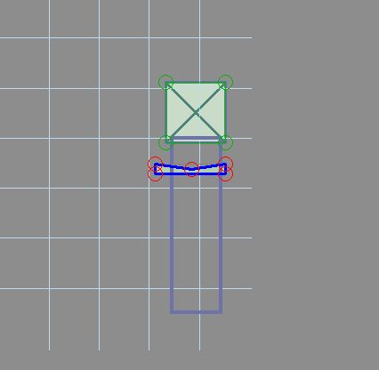

# 3. Serve and launch the first ball

**Goal:** start a game, serve a ball and launch it into the playfield.

Create a mechanical VPX plunger named `Plunger` at the foot of the right-hand shooter lane. Place a Trigger named `s_plunger` where the ball rests against it, and add that trigger to `glf_switches`. The resting ball must keep the trigger active; launching must let it leave the trigger.



The old illustration uses `sw01`; use `s_plunger` throughout this tutorial. Ensure the lane opens into the playfield and a launched ball cannot immediately escape the table.

## Add configuration and callback

Add these subs outside all other subs:

```vbscript
Sub ConfigureTutorialPlunger()
    With CreateGlfBallDevice("plunger")
        .BallSwitches = Array("s_plunger")
        .DefaultDevice = True
        .MechanicalEject = True
        .EjectTimeout = 2000
        .EjectCallback = "TutorialPlungerEject"
    End With
End Sub

Sub TutorialPlungerEject(ball)
    If IsObject(ball) Then
        ball.VelX = 0
        ball.VelY = -45
    End If
End Sub
```

Replace the empty `ConfigureGlfDevices` body with:

```vbscript
Sub ConfigureGlfDevices()
    ConfigureTutorialPlunger
End Sub
```

`DefaultDevice = True` identifies the destination of trough serves. `MechanicalEject = True` allows the ball to leave under manual plunger power. The two-second timeout is the interval used to confirm a mechanical exit; it does not launch the ball.

The callback supplies a simple automatic launch for the later ball-save chapter, using a shooter lane directed toward decreasing Y. It is deliberately separate from manual `Plunger.Fire`. Adjust the velocity for your geometry if necessary; never replace the ball. A pulse callback can receive `Null`, so the object check matters.

## First runtime checkpoint

Press Play, wait for initialization, then press and release the configured Start key. GLF checks the trough and starts the game on the key-up request. Exactly one ball should appear at the plunger. Hold and release the configured plunger key to launch it. The flippers are not wired yet, so let the ball drain.

Repeat the serve/drain cycle. The physical ball should return to the trough, and GLF should serve the next turn. After the third unsaved drain, the game should stop serving until Start is pressed again. The score display is added in chapter 5.

If the ball is served but GLF never sees it at the plunger, check trigger coverage, spelling and collection membership. If it cannot reach the playfield, correct lane geometry and plunger settings before adding scoring. If it cannot return to `swTrough1`, fix the trough route.

[Previous](tutorial-trough.md) · [Tutorial map](index.md) · [Next](tutorial-flippers.md)
