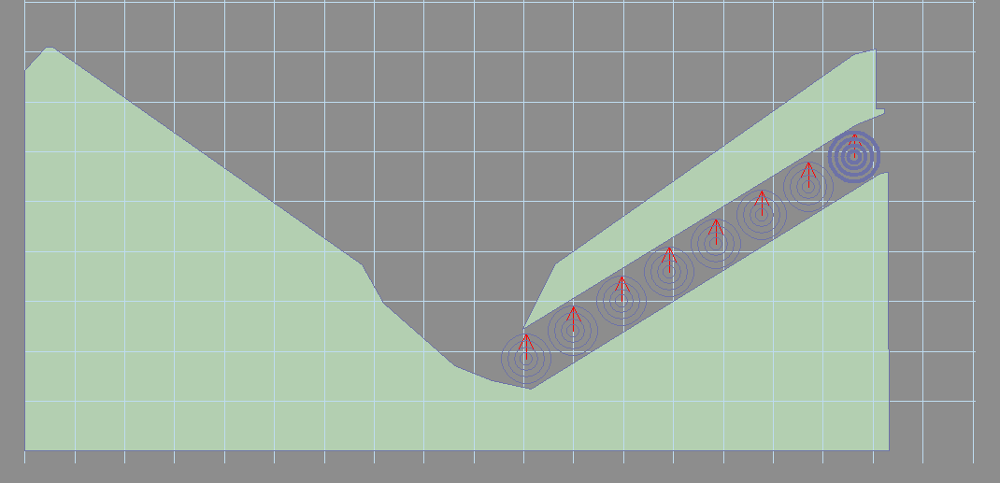

# 2. Build the physical trough

**Goal:** route the same physical ball from the drain back to the shooter lane without destroying it during play.

This tutorial uses `tnob = 1`: one release kicker called `swTrough1` and a separate collecting kicker called `Drain`. Place them under/behind the apron with walls separating the trough from the live playfield. Both must capture balls. Funnel both outlanes and the centre drain into `Drain`.

The illustrations show a larger trough. For this tutorial, retain only the `Drain` → `swTrough1` → shooter-lane route. Position the release kicker so its ejection reaches the bottom of the shooter lane and the ball settles onto `s_plunger`.

## Match the built-in kick directions

The checked-in trough code moves the ball using `Drain.Kick 57, 10` into the last trough slot and `swTrough1.Kick 90, 10` toward the shooter lane. Build the route to suit those directions; placing kickers anywhere on the table will not create a functioning trough. Use the old `tutorial/glf_tutorial_trough.vpx` as a geometry reference if you need to inspect the arrangement in VPX. Verify the route with visible kickers before hiding it under the apron.

For larger troughs, intermediate slots use `swTrough2` through `swTrough7`. The eight-ball case also stores a ball in `Drain`; do not extrapolate a nonexistent `swTrough8`. Stay with one ball until the core game works.

## Script ownership

There is no `CreateGlfBallDevice` call for the built-in trough. `Glf_Init` creates one ball at `swTrough1`, sets the last trough slot and populates `gBot`. GLF already defines `Drain_Hit`, `Drain_UnHit`, `swTrough1_Hit` and `swTrough1_UnHit`.

Do not put these kickers in `glf_switches`, write another drain handler, or destroy/recreate balls on each drain. The current trough uses `SetDelay` for its update; a separate `UpdateTroughTimer` is not needed despite an old comment in the source.

## Checkpoint after chapter 3

The trough can be tested once the default plunger device is registered. At startup, one ball must sit in `swTrough1`. Start must release that ball to the shooter lane. A later drain must enter `Drain`, transfer to the vacated `swTrough1`, and become available for the next serve. If start is rejected, check actual trough occupancy first; the game will not start with a missing ball.

[Previous](tutorial-setup.md) · [Tutorial map](index.md) · [Next](tutorial-plunger.md)
